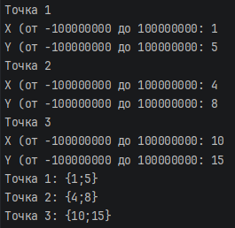
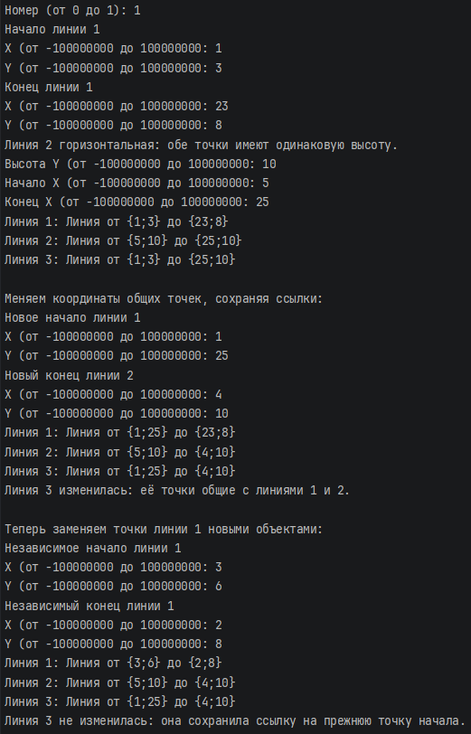
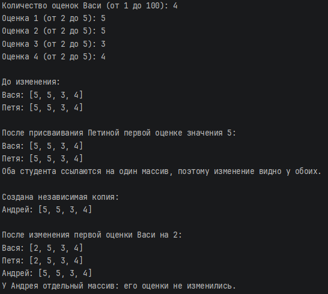
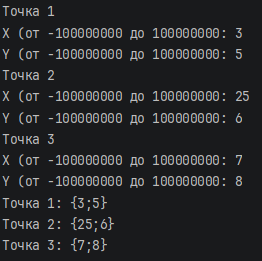
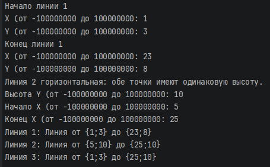
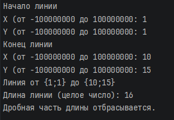

Гладышев Иван, ЛА-3

# Лабораторная работа №2

## Задание 1

### Задача 1 Точка координат

#### Текст задачи

Создать сущность Точка на двумерной плоскости с координатами X и Y и текстовым представлением «{X;Y}». Создать три точки с разными координатами и вывести их на экран.

#### Алгоритм решения

1. Описать класс Point с закрытыми полями x и y, обычными свойствами X и Y и конструктором с двумя параметрами.

2. Проверять конечность координат и диапазон от −100000000 до 100000000. Ограничение обеспечивает безопасное вычисление целочисленной длины линии.

3. Создать три объекта Point. При ручном вводе повторяющиеся пары координат не принимать.

4. Переопределить ToString() и вывести координаты каждой точки.

#### Тестирование

## Задание 2

### Задача 1 Прямая

#### Текст задачи

Создать сущность Линия с началом и концом типа Точка и строкой «Линия от {X1;Y1} до {X2;Y2}». Создать линию 1 от {1;3} до {23;8}, горизонтальную линию 2 от {5;10} до {25;10} и линию 3 с началом линии 1 и концом линии 2. Изменить первые две линии с изменением третьей, затем изменить первую без изменения третьей.

#### Алгоритм решения

1. Создать класс Line с полями start и end, свойствами Start и End, конструкторами и методом ToString().

2. Создать первые две линии. В третью передать ссылки first.Start и second.End.

3. Изменить свойства координат общих точек: начало первой на {2;4}, конец второй на {30;10}. Третья линия также изменится.

4. Присвоить Start и End первой линии новые объекты {100;100} и {200;200}. Третья сохранит прежние точки.

5. Вывести все линии до изменений и после каждого этапа.

#### Тестирование

## Задание 3

### Задача 1 Студент

#### Текст задачи

Создать сущность Студент с именем, массивом целых оценок и представлением «Имя: \[оценка1, оценка2, …\]». Создать Васю с оценками 3, 4, 5; присвоить Пете ссылку на оценки Васи; изменить первую оценку Пети на 5 и объяснить результат. Создать Андрею независимую копию оценок Васи.

#### Алгоритм решения

1. Описать класс Student с полями name и grades, свойствами Name и Grades, конструктором и ToString().

2. Создать Васю и Петю, передав Пете vasya.Grades. Оба объекта используют один массив.

3. Выполнить petya.Grades\[0\] = 5 и вывести обоих студентов.

4. Методом CopyGrades() создать новый массив и в цикле скопировать элементы. Передать его Андрею.

5. Изменить первую оценку Васи на 2 и вывести всех студентов для проверки независимости копии.

#### Тестирование

## Задание 4

### Задача 1 Создаём точку

#### Текст задачи

Изменить сущность Точка так, чтобы объект можно было создать только с указанием обеих координат X и Y. Создать и вывести точки {3;5}, {25;6}, {7;8}.

#### Алгоритм решения

1. Использовать класс Point, разработанный для задания 1.1.

2. Объявить единственный конструктор Point(double x, double y). Конструктор без параметров не объявлять.

3. Передать координаты через конструктор и присвоить их свойствам с проверкой значений.

4. Создать три требуемых объекта и вывести результат ToString().

#### Тестирование

### Задача 2 Создаём линию

#### Текст задачи

Изменить сущность Линия: предусмотреть создание по двум объектам Точка и по четырём числам x1, y1, x2, y2. Создать линию 1 от {1;3} до {23;8}, горизонтальную линию 2 от {5;10} до {25;10} и линию 3 с общим началом первой и общим концом второй линии.

#### Алгоритм решения

1. В классе Line объявить конструктор Line(Point start, Point end). Проверить, что точки не равны null.

2. Добавить Line(double x1, double y1, double x2, double y2), вызывающий первый конструктор через this.

3. Первую линию создать по двум точкам, вторую — по четырём числам.

4. Третью линию создать по ссылкам first.Start и second.End, не копируя точки.

5. Вывести текстовое представление всех трёх линий.

#### Тестирование

## Задание 5

### Задача 3 Длина линии

#### Текст задачи

Добавить сущности Линия из задания 4.2 метод, возвращающий расстояние между началом и концом в виде целого числа. Создать линию от {1;1} до {10;15} и вывести её длину.

#### Алгоритм решения

1. Использовать свойства Start и End класса Line.

2. Вычислить разности координат dx = End.X − Start.X и dy = End.Y − Start.Y.

3. В методе GetLength() вычислить Math.Sqrt(dx \* dx + dy \* dy).

4. Преобразовать результат в int с отбрасыванием дробной части. Способ округления в условии не задан; в программе явно принято усечение.

5. Создать линию, вывести ToString() и результат GetLength().

#### Тестирование

